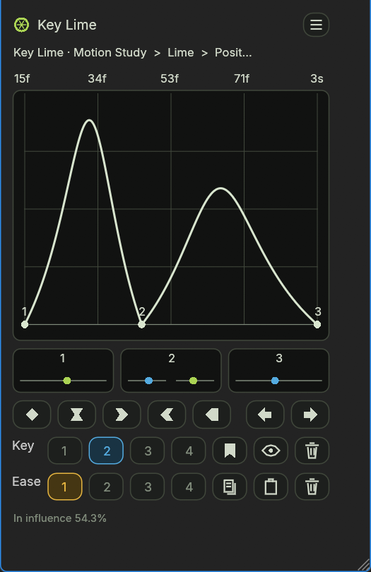

# Key Lime 1.0.1

A native dockable **EffectCraft 0.11.1** ScriptUI panel for stashing keyframe selections and editing easing. The compact graph, controllers, interpolation toolbar, and two rows of four slots follow the Ease Stash reference. Rounded outlined buttons follow the neighboring GridBase project, with a lime accent and original vector icons.

## Open the panel

Choose **Window → Key Lime.jsx**. Select timeline keyframes and move the pointer over the panel. Give the dock about **320 × 540 logical pixels**, or drag its tab into a floating dock. EffectCraft adds scrollbars when its dock is smaller than the ScriptUI content.

To install manually, choose **File → Scripts → Install ScriptUI Panel…**, select **dist/Key Lime.jsx**, then open it from Window. On Windows, `node install.mjs` installs the same standalone file and backs up an older Key Lime version into this project's archive folder. No icons, libraries, network access, or companion files are required at runtime.

## Controls

| Control | Action |
|---|---|
| Graph | Shows speed over time, with one color per property, up to eight properties. Click a key dot to show its controller page when more than eight keys are selected. |
| Numbered controller | Drag lime outgoing handles right for more influence; drag blue incoming handles left. Middle keys have separate tracks: incoming on the left, outgoing on the right. Click to enter exact influence and normalized speed. |
| Drag modifiers | Shift: finer movement. Alt: change normalized speed (right increases speed on either side). Ctrl: edit the same side of every selected key. |
| Five interpolation icons | Linear, Easy Ease, Ease Out, Ease In, Hold. |
| Arrows | Nudge all displayed keys by one composition frame; Shift-click for ten frames. Collisions with unselected keys are rejected. |
| Key 1–4 | Click an empty slot to stash the displayed selection. Click a filled slot to recall its source without switching compositions. Shift-click replaces; Alt-click clears. |
| Bookmark / eye / trash | Stash displayed keys, reveal their source in the timeline, clear the active Key slot. |
| Ease 1–4 | Click an empty slot to store the first property's easing. Click a filled slot to apply it to all displayed properties. Shift-click reverses; Ctrl-click replaces; Alt-click clears. |
| Copy / paste / trash | Store easing, paste the active ease (Shift for reversed), clear the active Ease slot. |
| Menu | Shortcut guide, explicit timeline refresh, and clear all Key slots. |

Influence drags preserve the existing speed, including Position path speed and both sides of automatic middle keys. Version 1.0.1 fixes older drags that could introduce a negative component velocity or reset an automatic handle. Already altered curves retain their current values; undo an old edit or apply Easy Ease to reset them.

Every completed edit, paste, nudge, and continuous drag has one Undo step. Incoming and outgoing interpolation are preserved when editing only the other side. Ease reuse scales speeds to each destination segment's duration and value change, including per-dimension Scale and motion-path distance for Position. Equal key counts copy every stored key; other counts reuse the first outgoing and last incoming sides.

Key slots are held in panel memory. Ease slots persist through `app.settings` and survive relaunches. Selecting new timeline keys and hovering returns to the current selection. A recalled Key slot remains available while the timeline has no key selection.

## Compatibility and limits

- Uses EffectCraft's native key/property IDs and targeted command API; this build targets EffectCraft, not Adobe After Effects.
- Layer renames, reordered layers, inserted keys, and precomposition are resolved by IDs. Moved keys can be recovered by a unique value match. Missing or ambiguous keys produce an error instead of selecting the nearest key. There is no stable per-key UUID in this host, so a deleted key recreated at exactly the same time is indistinguishable from the original.
- Roving keys are skipped for easing. Disable Roving before nudging them. Locked layers and unsupported non-interpolating properties are rejected.
- Live selection refresh happens on pointer entry/movement; it does not depend on background script timers. An explicit Read timeline action is available in the menu.
- The host does not expose a document-open event to ScriptUI. Key slots clear on file-path changes (including Save As) or an observed history reset. If a second unsaved project or the same file is opened and edited before the pointer returns, use **Clear Key slots** or reopen the panel. Never carry Key slots between documents. Ease slots are reusable across documents.
- Ease snapshots reject nonzero velocity between equal endpoint values because a relative speed cannot be defined for that segment; those curves still display correctly.
- The graph shows the dominant changing dimension for non-spatial vectors and path speed for spatial properties. Units may differ between overlaid properties; the graph uses one shared peak scale. Zero-duration spans and exact singular speed peaks are bounded for drawing.
- Multi-property Key slots require all their source keys to resolve. If one property is deleted, clear and restash the slot.
- Custom ScriptUI drawing and the host's dock chrome differ from AE's extension rendering. This is an independent implementation of the reference workflow, with the requested GridBase styling adaptations.

## Files and verification

Verified in installed EffectCraft 0.11.1: **67 engine assertions and 38 native UI assertions passed**. Native checks include incoming slider direction with two and three selected keys, independent middle tracks, mouse drags, modifiers, dialogs, undo, slot persistence writes, cross-composition recall, and missing-key recovery. Engine regressions cover Position path-speed preservation and automatic middle-key easing.

- `dist/Key Lime.jsx` — standalone installable panel.
- `src/core.js` — addressing, easing, reuse, nudge, and speed-graph mathematics.
- `src/panel.js` — native UI, vector icons, gesture handling, and slot storage.
- `assets/` — editable SVG logo and icon sheet; runtime icons are embedded drawing paths.
- `Key Lime Demo.ecproj` — motion study plus a second composition for easing reuse.
- `tests/engine-results.txt`, `tests/ui-results.json`, `tests/advanced-ui-results.json`, `tests/sliders-ui-results.json` — installed-engine and native-interaction results.
- `tests/Key-Lime-sliders.png` — actual EffectCraft screenshot of the split slider tracks.

Build with `node build.mjs`. Run engine checks with `node tests/run.mjs`. UI tests require the **isolated test instance** launched by `node tests/launch.mjs`; `node tests/ui.mjs` resets only that instance's test project on localhost port 9877. Do not point the test bridge at a working project.

## Reference sources

- [Ease Stash product page and public demonstrations](https://aescripts.com/ease-stash/)
- [EffectCraft plugin documentation](https://github.com/storytold/effectcraft/blob/main/docs/plugins.md)
- [EffectCraft scripting implementation](https://github.com/storytold/effectcraft/blob/main/crates/script/src/prelude.js)
- [EffectCraft temporal interpolation](https://github.com/storytold/effectcraft/blob/main/crates/keyframe/src/lib.rs)

No Ease Stash proprietary code or bundled assets are included. Icons are drawn specifically for Key Lime.
